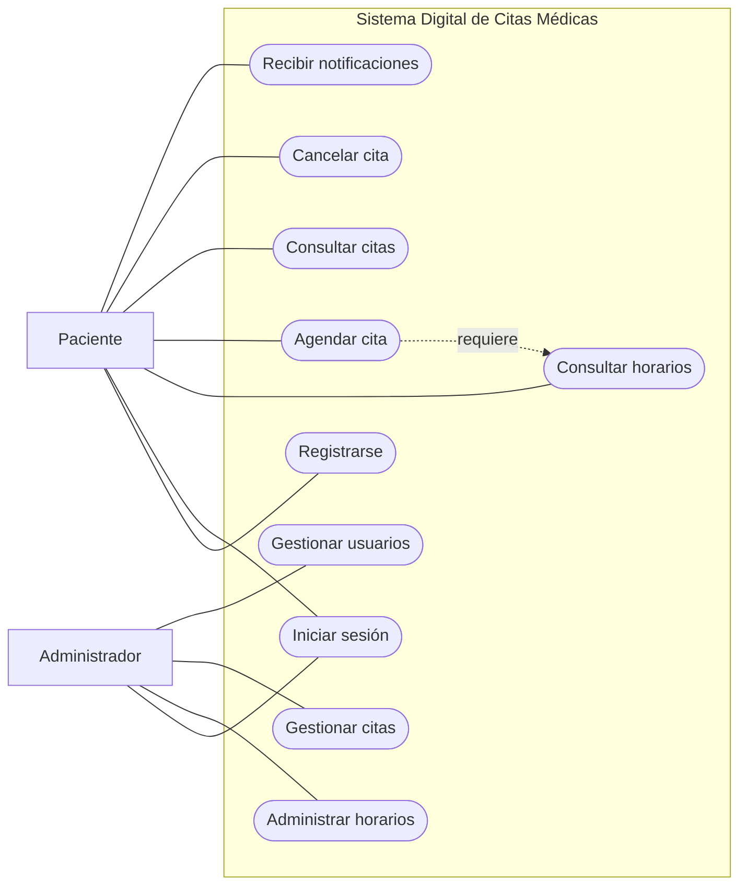
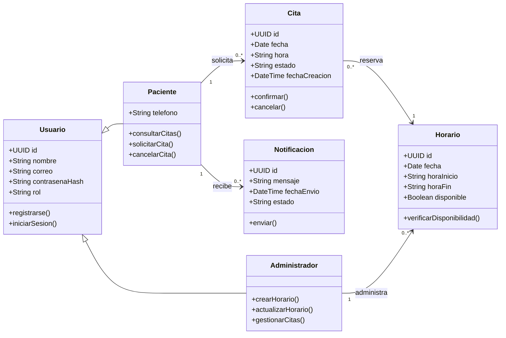
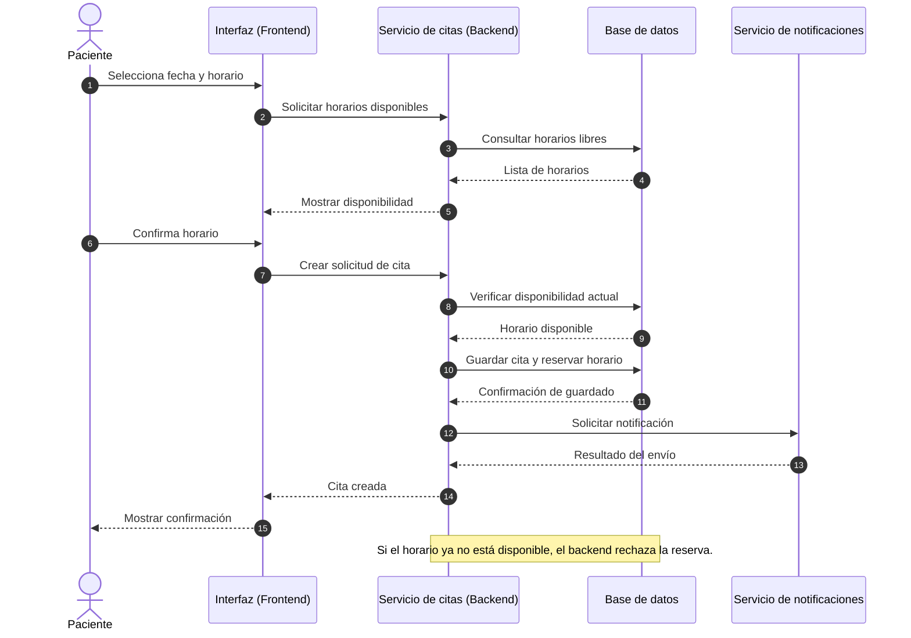
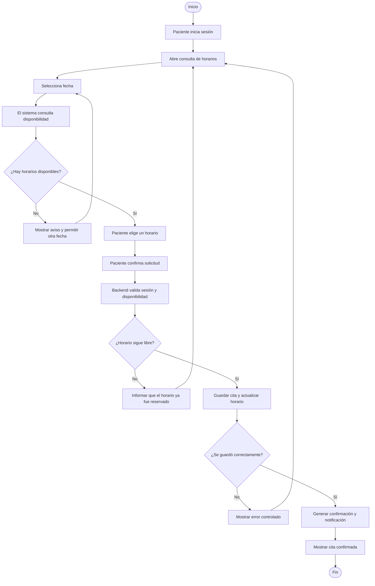
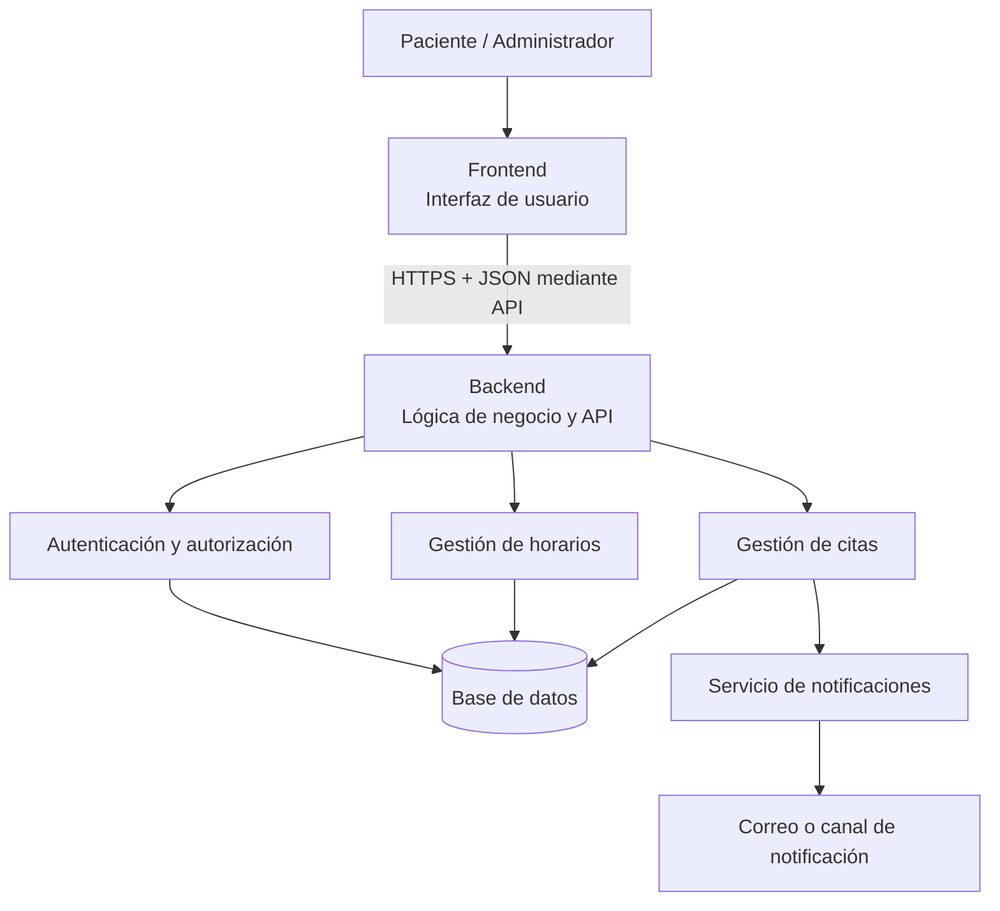

# Diagramas del Sistema Digital de Citas Médicas

Estas visualizaciones se reconstruyeron a partir de la información del proyecto que se pudo recuperar. Son una base de trabajo editable y deben compararse con los modelos originales de Visual Paradigm antes de considerarlas equivalentes. El diagrama de casos de uso UML en formato PlantUML está en [01-casos-de-uso.puml](01-casos-de-uso.puml).

## 1. Casos de uso — vista general

## 2. Diagrama de clases

## 3. Diagrama de secuencia: agendar una cita

## 4. Diagrama de actividad: agendar una cita

## 5. Diagrama de arquitectura inicial

## Alcance de estos modelos

Los diagramas representan el diseño propuesto, no una aplicación implementada. Las tecnologías específicas, reglas clínicas, permisos detallados, políticas de privacidad y mecanismo final de notificaciones todavía requieren definición. La verificación de disponibilidad debe realizarse en el backend para evitar reservas duplicadas.
