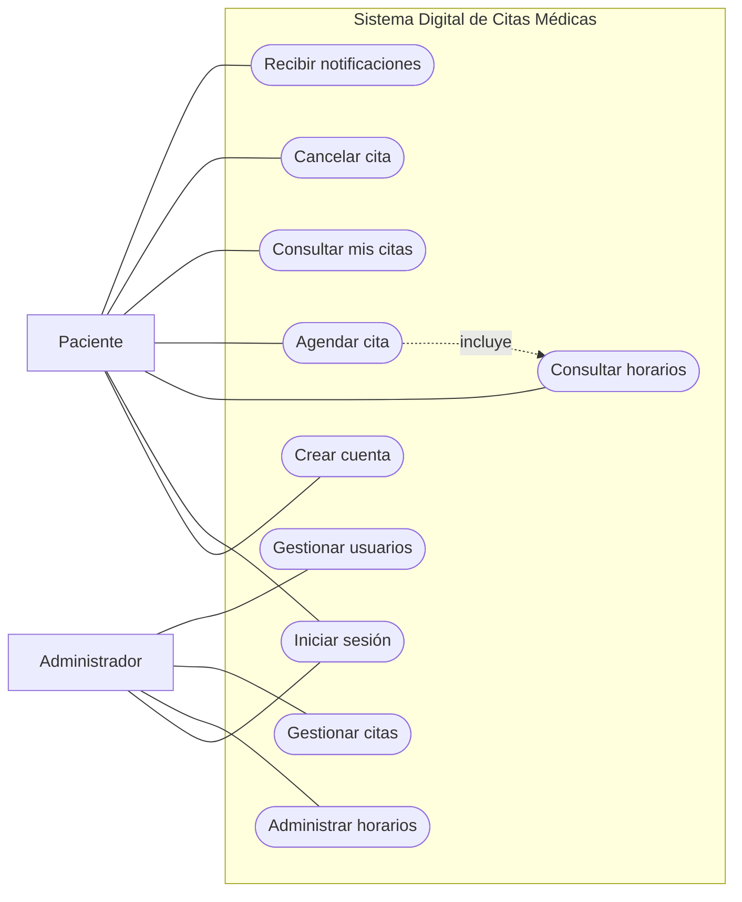
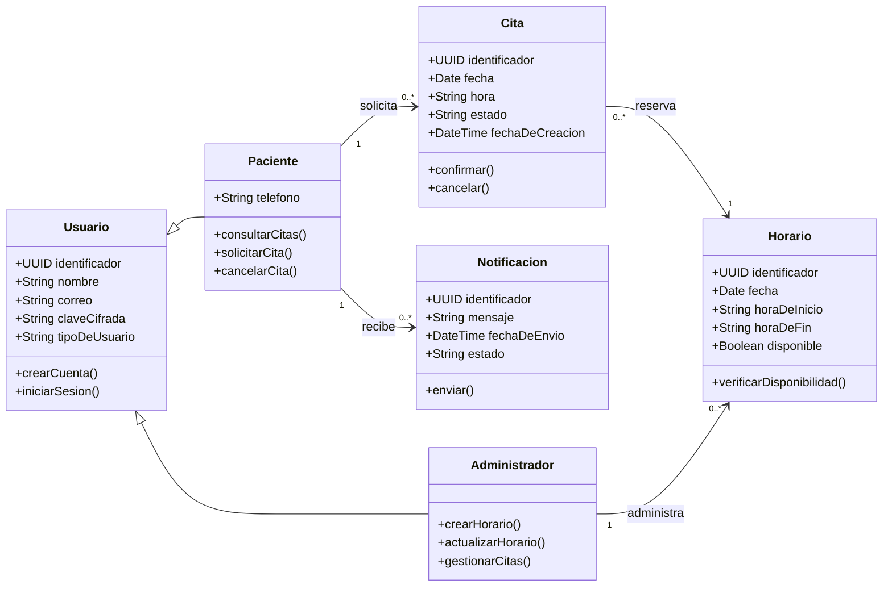
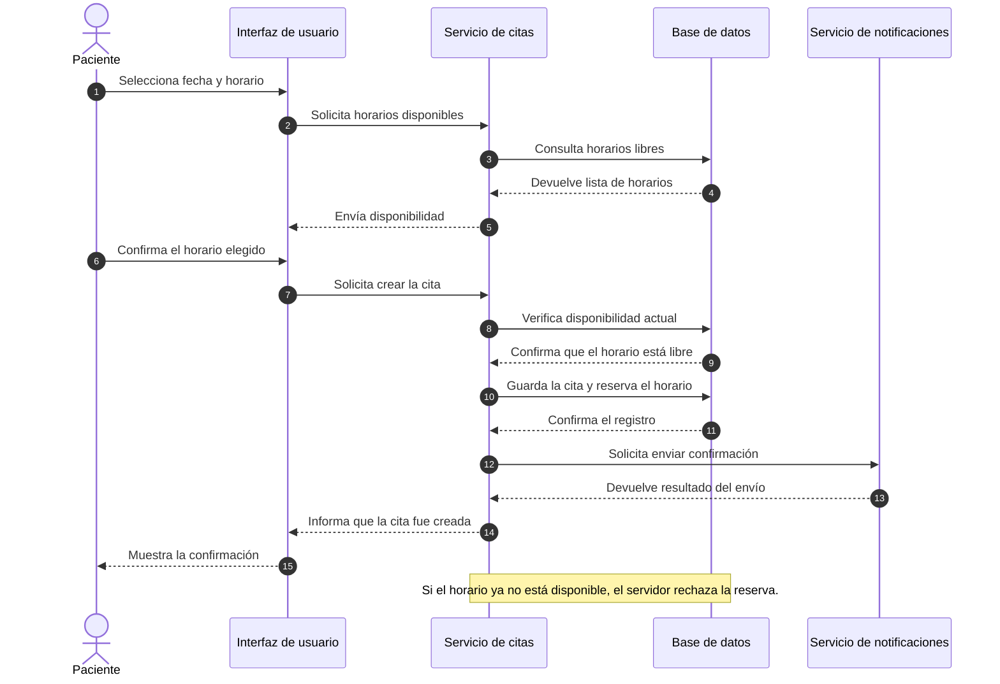
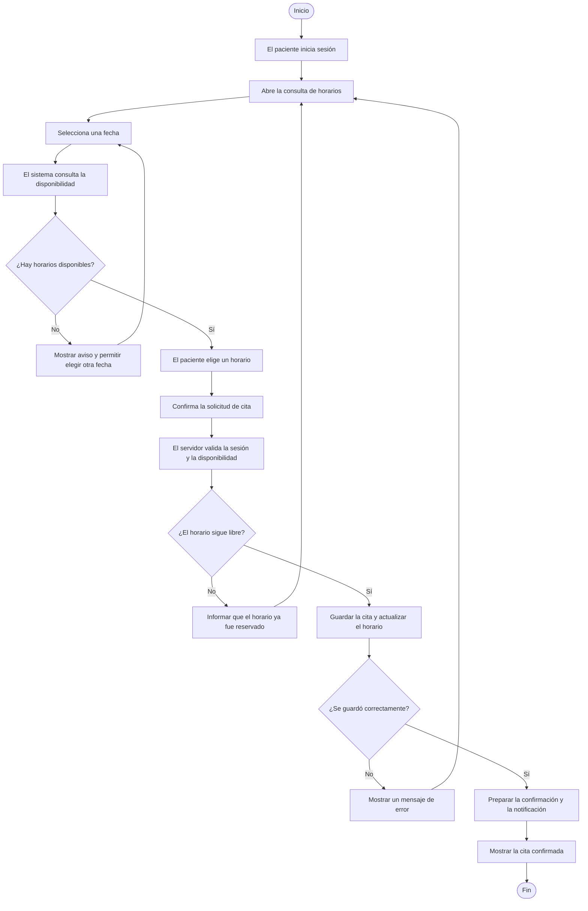
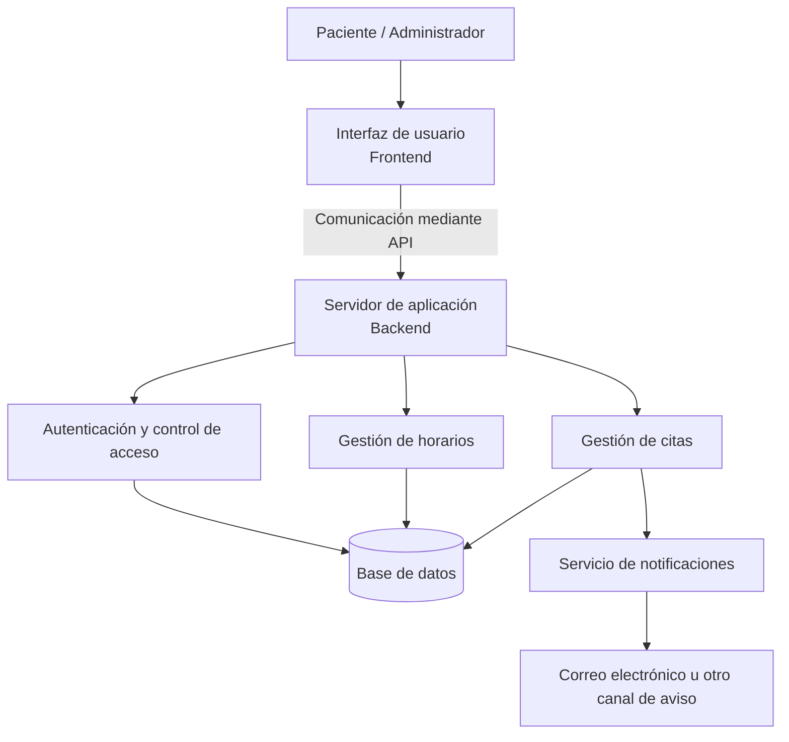

# Diagramas del Sistema Digital de Citas Médicas

Esta página reúne las reconstrucciones editables de los diagramas del proyecto, con etiquetas y descripciones en español. Se elaboraron a partir de la información que pudimos recuperar; por eso, deben compararse con los modelos originales de Visual Paradigm antes de considerarlas equivalentes.

## 1. Diagrama de casos de uso

Representa las funciones principales disponibles para el paciente y el administrador. El archivo UML editable está en [01-casos-de-uso.puml](01-casos-de-uso.puml).

## 2. Diagrama de clases

Describe las clases principales del sistema, sus datos, operaciones y relaciones.

## 3. Diagrama de secuencia: agendar una cita

Muestra cómo se comunican el paciente, la interfaz, el servicio de citas, la base de datos y el servicio de notificaciones durante una reserva.

## 4. Diagrama de actividad: agendar una cita

Presenta el flujo de acciones y decisiones que se siguen para registrar una cita.

## 5. Diagrama de arquitectura inicial

Muestra la separación propuesta entre la interfaz, el servidor, los módulos principales y el almacenamiento de información.

## Aclaraciones

- Los nombres, acciones y descripciones de los diagramas están en español; se conservan algunas siglas técnicas conocidas, como API, y términos entre paréntesis para reconocer frontend y backend.
- Los archivos fuente se pueden editar desde GitHub.
- Los modelos representan una propuesta de diseño; no demuestran que exista una aplicación implementada.
- Las reconstrucciones deben compararse con los archivos originales de Visual Paradigm para confirmar detalles y relaciones.
